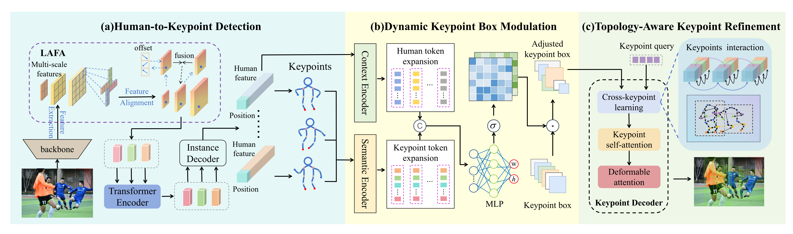

# Learning Topology-Aware Dynamic Associations for Robust Multi-Person Pose Estimation

## Method



## Environment

### Installation

The code is developed and validated with `python=3.9.21,pytorch=2.5.1,cuda=12.1`. 

1. Create a new virtual environment.

   ```
   conda create -n TopoDA python=3.9.21
   conda activate TopoDA
   ```

2. Install Pytorch and torchvision.

   ```
   conda install pytorch==2.5.1 torchvision==0.20.1 torchaudio==2.5.1 pytorch-cuda=12.1 -c pytorch -c nvidia
   ```
3. Clone this repo.

4. Install other needed packages.

   ```
   pip install pycocotools timm termcolor opencv-python addict yapf scipy
   pip install -r requirements.txt
   ```
5. Download the COCO API and Crowdpose API.

   ```
   git clone https://github.com/cocodataset/cocoapi.git
   cd cocoapi/PythonAPI
   make install
   ```
   The [Crowdpose API](https://github.com/jeffffffli/CrowdPose/tree/master/crowdpose-api) is the same.


### Data Preparation

1. Please download from [COCO download](http://cocodataset.org/#download), 2017 Train/Val is needed for training and evalutation.
2. Please download from [CrowdPose download](https://github.com/Jeff-sjtu/CrowdPose#dataset), Train/Val is training and evaluation.

## Run

### Evaluation on COCO

```
export TopoDA_COCO_PATH=/path/to/your/coco/dataset
```

```
torchrun --nproc_per_node=4 main.py --output_dir "/path/to/your/output_dir" -c config/TopoDA.cfg.py --options batch_size=2 epochs=60 num_body_points=17 backbone='resnet50' --dataset_file="coco"  --pretrain_model_path "/path/to/your/checkpoint.pth" --eval
```

### Evaluation on CrowdPose

```
export TopoDA_CrowdPose_PATH=/path/to/your/crowdpose/dataset
```

```
torchrun --nproc_per_node=4 main.py --output_dir "/path/to/your/output_dir" -c config/TopoDA.cfg.py --options batch_size=2 epochs=80 num_body_points=14 backbone='resnet50' --dataset_file="crowdpose"  --pretrain_model_path "/path/to/your/checkpoint.pth" --eval
```

## TODOS:
- [ ] Training code release
- [ ] Update the code
