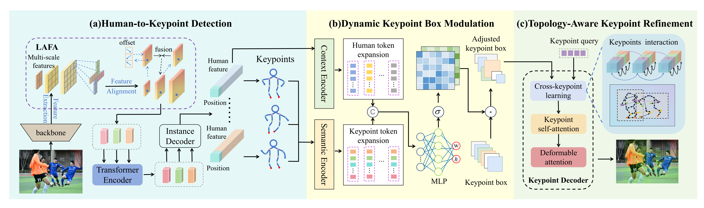

# Learning Topology-Aware Dynamic Associations for Robust Multi-Person Pose Estimation

## 方法

**TopoDA** 是一个学习拓扑感知动态关联的端到端多人姿态估计框架。它通过局部感知特征对齐（LAFA）、动态关键点框调制（DKBM）和拓扑感知细化三个阶段，逐步完成由粗到细的姿态估计。通过对齐多尺度特征、自适应调整关键点区域，并建模人体内部及不同人体之间的关节关系，TopoDA 处理遮挡和密集交互场景中的关键点歧义。



## 环境安装

### 安装步骤

本版本使用 `Python 3.11`、`PyTorch 2.7.1`、`torchvision 0.22.1` 和 `CUDA 12.8`。请在 Linux 环境中准备 CUDA Toolkit 12.8（含 `nvcc`）和 C++ 编译器。

1. 创建并激活 Conda 环境。

    ```bash
    conda create -n TopoDA python=3.11 -y
    conda activate TopoDA
    ```

2. 安装 PyTorch 和 torchvision。

    ```bash
    python -m pip install --upgrade pip setuptools wheel
    python -m pip install torch==2.7.1 torchvision==0.22.1 --index-url https://download.pytorch.org/whl/cu128
    ```

3. 克隆仓库。

    ```bash
    git clone https://github.com/suiyingliuxin/TopoDA.git
    cd TopoDA
    ```

4. 安装其他依赖及 COCO API。

    ```bash
    python -m pip install -r requirements.txt
    ```

    `requirements.txt` 已包含 `pycocotools`；CrowdPose API 随代码提供，位于 `crowdposetools/`。

5. 编译 DCNv4 和多尺度可变形注意力算子。

    ```bash
    bash scripts/build_ops.sh
    ```

## 数据准备

### CrowdPose

下载 [CrowdPose](https://github.com/jeffffffli/CrowdPose#dataset)，整理为：

```text
data/crowdpose/
├── images/
└── json/
    ├── crowdpose_train.json
    ├── crowdpose_val.json
    ├── crowdpose_trainval.json
    └── crowdpose_test.json
```

也可以使用下载脚本：

```bash
python -m pip install -r requirements-data.txt
python scripts/download_crowdpose.py --root data/crowdpose
```

缺少 `crowdpose_trainval.json` 时，运行 `python scripts/merge_crowdpose.py data/crowdpose`。

### COCO

从 [COCO 2017](https://cocodataset.org/#download) 下载图片和人体关键点标注：

```text
data/coco/
├── train2017/
├── val2017/
└── annotations/
    ├── person_keypoints_train2017.json
    └── person_keypoints_val2017.json
```

## 运行

多卡示例使用单机 4 卡，按实际 GPU 数量修改 `--nproc_per_node`。`batch_size=2` 表示每卡 2 张，4 卡总 batch size 为 8。多卡训练和恢复训练示例开启 EMA。

### 骨干网络权重

下载 Swin-T 的 ImageNet 初始化权重：

```bash
mkdir -p weights
curl -L --fail --retry 3 \
  https://github.com/SwinTransformer/storage/releases/download/v1.0.0/swin_tiny_patch4_window7_224.pth \
  -o weights/swin_tiny_patch4_window7_224.pth
```

### CrowdPose 训练

**单卡**

```bash
python main.py -c config/topoda_crowdpose_swint.py \
  --crowdpose_path data/crowdpose \
  --backbone_weights weights/swin_tiny_patch4_window7_224.pth \
  --output_dir runs/crowdpose_swint --num_workers 6 --amp --eval_split test \
  --options crowdpose_train_split=trainval
```

**单机 4 卡**

```bash
torchrun --standalone --nnodes=1 --nproc_per_node=4 main.py \
  -c config/topoda_crowdpose_swint.py \
  --crowdpose_path data/crowdpose \
  --backbone_weights weights/swin_tiny_patch4_window7_224.pth \
  --output_dir runs/crowdpose_swint_4gpu --num_workers 4 \
  --amp --eval_split test --find_unused_params \
  --options crowdpose_train_split=trainval batch_size=2 use_ema=True
```

使用 ResNet-50 时，切换为 `config/topoda_crowdpose_r50.py`，省略 `--backbone_weights`。

### 恢复训练

**单卡**

```bash
python main.py -c config/topoda_crowdpose_swint.py \
  --crowdpose_path data/crowdpose --output_dir runs/crowdpose_swint \
  --resume runs/crowdpose_swint/checkpoint.pth --amp --eval_split test \
  --options crowdpose_train_split=trainval
```

**单机 4 卡**

```bash
torchrun --standalone --nnodes=1 --nproc_per_node=4 main.py \
  -c config/topoda_crowdpose_swint.py \
  --crowdpose_path data/crowdpose --output_dir runs/crowdpose_swint_4gpu \
  --resume runs/crowdpose_swint_4gpu/checkpoint.pth \
  --amp --eval_split test --find_unused_params \
  --options crowdpose_train_split=trainval batch_size=2 use_ema=True
```

恢复时保持原实验的配置和数据划分选项。

### CrowdPose 评测

**单卡**

```bash
python main.py -c config/topoda_crowdpose_swint.py \
  --crowdpose_path data/crowdpose --eval --eval_split test \
  --resume runs/crowdpose_swint/checkpoint_best.pth \
  --output_dir runs/crowdpose_eval --save_results --amp
```

**单机 4 卡**

```bash
torchrun --standalone --nnodes=1 --nproc_per_node=4 main.py \
  -c config/topoda_crowdpose_swint.py \
  --crowdpose_path data/crowdpose --eval --eval_split test \
  --resume runs/crowdpose_swint_4gpu/checkpoint_best.pth \
  --output_dir runs/crowdpose_eval_4gpu --save_results --amp
```

评测 val 时，使用 `--eval_split val` 和对应的 train/val checkpoint。

### COCO 训练与评测

**单卡**

```bash
# 训练
python main.py -c config/TopoDA.cfg.py \
  --dataset_file coco --coco_path data/coco \
  --output_dir runs/coco_r50 --amp

# 评测
python main.py -c config/TopoDA.cfg.py \
  --dataset_file coco --coco_path data/coco --eval --eval_split val \
  --resume runs/coco_r50/checkpoint_best.pth \
  --output_dir runs/coco_eval --save_results --amp
```

**单机 4 卡**

```bash
# 训练
torchrun --standalone --nnodes=1 --nproc_per_node=4 main.py \
  -c config/TopoDA.cfg.py \
  --dataset_file coco --coco_path data/coco \
  --output_dir runs/coco_r50_4gpu --amp --find_unused_params \
  --options batch_size=2 use_ema=True

# 评测
torchrun --standalone --nnodes=1 --nproc_per_node=4 main.py \
  -c config/TopoDA.cfg.py \
  --dataset_file coco --coco_path data/coco --eval --eval_split val \
  --resume runs/coco_r50_4gpu/checkpoint_best.pth \
  --output_dir runs/coco_eval_4gpu --save_results --amp
```

### 图片推理

```bash
python infer.py -c config/topoda_crowdpose_swint.py \
  --checkpoint runs/crowdpose_swint/checkpoint_best.pth \
  --input path/to/image_or_directory --output_dir runs/inference --amp
```

## 引用

如果 TopoDA 对你有帮助，欢迎点一个 ⭐ Star，关注项目后续更新。如果在研究中使用本项目，请引用我们的论文：

```bibtex
@inproceedings{hu2026learning,
  title={Learning topology-aware dynamic associations for robust multi-person pose estimation},
  author={Hu, Shengnan and Liu, Yandong and Liu, Jiangnan and Chen, Yahong},
  booktitle={Proceedings of the AAAI Conference on Artificial Intelligence},
  volume={40},
  number={6},
  pages={4914--4922},
  year={2026}
}
```
